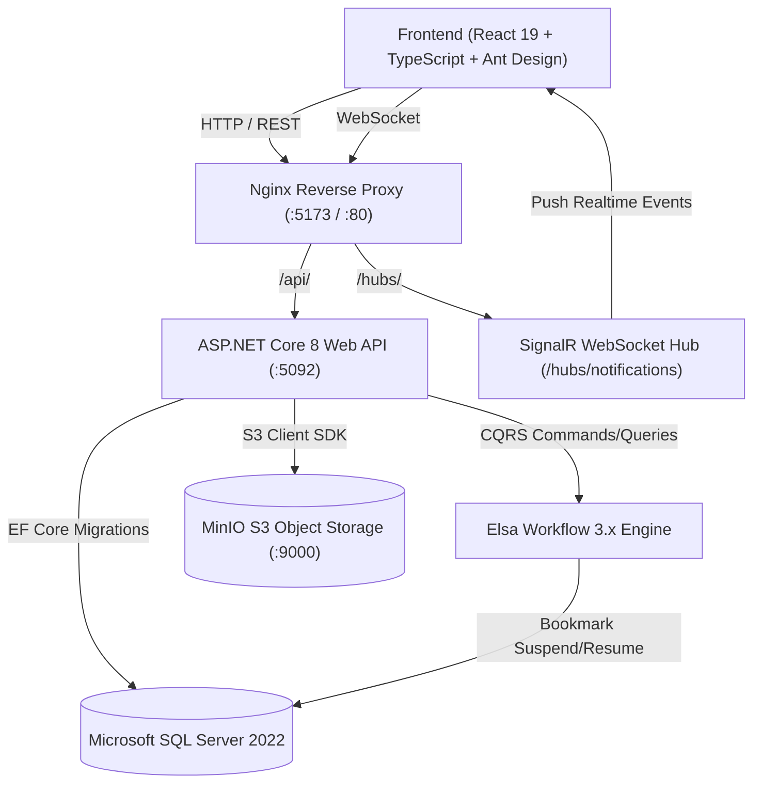
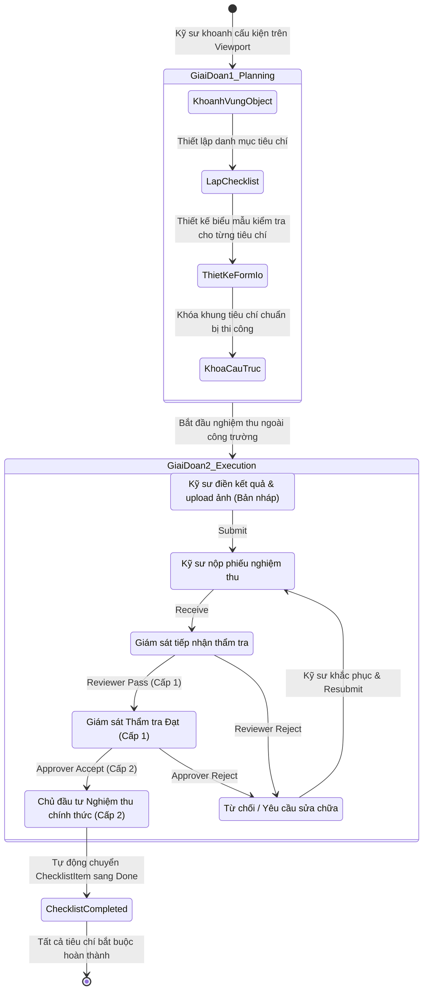

# 🎓 BÁO CÁO TỔNG KẾT CUỐI KHÓA & BẢO VỆ SẢN PHẨM DỰ ÁN
# HỆ THỐNG QUẢN LÝ NGHIỆM THU CÔNG TRÌNH XÂY DỰNG (CONSTRUCTINSPECT)

> **Dự án:** ConstructInspect — Construction Drawing, Inspection & Checklist Workflow Management System  
> **Thời điểm Review:** Tuần 15  
> **Kiến trúc:** Clean Architecture (.NET 8) + React 19 / TypeScript + Elsa Workflow 3.x + SignalR + Docker Compose  

---

## 📑 MỤC LỤC

1. [PHẦN 1: CÔNG NGHỆ LÕI & KIẾN TRÚC KỸ THUẬT HỆ THỐNG](#phần-1-công-nghệ-lõi--kiến-trúc-kỹ-thuật-hệ-thống)
   - 1.1. Kiến trúc tổng thể Clean Architecture 4 lớp
   - 1.2. Mẫu thiết kế CQRS & MediatR Pipeline
   - 1.3. Cơ chế hoạt động của Elsa Workflow 3.x (State Machine & Bookmarks)
   - 1.4. Công nghệ thị giác máy tính trên Bản vẽ (Smart CV Viewport & AutoArc)
   - 1.5. Động cơ biểu mẫu động Form.io & Lưu trữ linh hoạt
   - 1.6. Truyền thông thời gian thực Realtime với SignalR WebSocket
   - 1.7. Hạ tầng Container hóa Docker Compose & Nginx Reverse Proxy
2. [PHẦN 2: NGHIỆP VỤ XÂY DỰNG HỆ THỐNG](#phần-2-nghiệp-vụ-xây-dựng-hệ-thống)
   - 2.1. Bài toán thực tế trong quản lý chất lượng thi công xây dựng
   - 2.2. Quy trình nghiệm thu 2 giai đoạn (Planning & Inspection)
   - 2.3. Ma trận phân quyền 4 vai trò nghiêm ngặt (RBAC Matrix)
   - 2.4. Vòng đời dữ liệu và tính bất biến của Hồ sơ Audit Trail
3. [PHẦN 3: KẾT NỐI HỆ THỐNG, TESTCASES & LIVE API TEST EVIDENCE](#phần-3-kết-nối-hệ-thống-testcases--live-api-test-evidence)
   - 3.1. Sơ đồ kết nối luồng dữ liệu liên thành phần
   - 3.2. Danh mục các Testcase cốt lõi của hệ thống
   - 3.3. Bằng chứng kiểm thử thực tế (Live API Test Evidence)
4. [PHẦN 4: BÀI BÁO CÁO ĐÀO TẠO & QUY TRÌNH ỨNG DỤNG AI TRONG XÂY DỰNG PHẦN MỀM](#phần-4-bài-báo-cáo-đào-tạo--quy-trình-ứng-dụng-ai-trong-xây-dựng-phần-mềm)
   - 4.1. Các kiến thức chuyên môn đã tích lũy trong quá trình Training
   - 4.2. Quy trình 4 bước chuẩn mực trước khi xây dựng tính năng
   - 4.3. Phương pháp luận ứng dụng AI trong Software Engineering hiện đại
   - 4.4. Đánh giá kết quả & Hướng phát triển tiếp theo

---

# PHẦN 1: CÔNG NGHỆ LÕI & KIẾN TRÚC KỸ THUẬT HỆ THỐNG



### 1.1. Kiến trúc tổng thể Clean Architecture 4 lớp
Hệ thống Backend được thiết kế theo đúng tôn chỉ **Clean Architecture / Onion Architecture**, đảm bảo tính độc lập tối đa với cơ sở dữ liệu và thư viện bên ngoài:
1. **Domain Layer (`ConstructionProject.Domain`)**:
   - Trái tim của hệ thống: Chứa các Entity thuần túy (`User`, `Role`, `DrawingFile`, `ConstructionObject`, `FormInspection`, `Checklist`, `ChecklistItem`, `InspectionAuditHistory`).
   - Định nghĩa Enums trạng thái (`InspectionStatus`, `ChecklistItemStatus`, `ChecklistStatus`).
   - Không phụ thuộc vào bất kỳ framework hay database provider nào.
2. **Application Layer (`ConstructionProject.Application`)**:
   - Chứa toàn bộ nghiệp vụ ứng dụng: Commands, Queries, DTOs, Behaviors, Interfaces (`IApplicationDbContext`, `IInspectionWorkflowService`, `INotificationService`, `IFileStorageService`).
   - Ứng dụng mô hình **CQRS** qua thư viện **MediatR**.
   - Kiểm thực dữ liệu đầu vào chặt chẽ qua **FluentValidation**.
3. **Infrastructure Layer (`ConstructionProject.Infrastructure`)**:
   - Triển khai cụ thể các interface công nghệ: `ApplicationDbContext` (Entity Framework Core 8), `MinioFileStorageService` (AWS S3/MinIO SDK), `Elsa Workflow Engine 3.2`, `SignalRNotificationService` và `JwtTokenGenerator`.
4. **API / Presentation Layer (`ConstructionProject.API`)**:
   - Điểm đón nhận request: REST Controllers (`AuthController`, `DrawingsController`, `ObjectsController`, `InspectionsController`, `ChecklistsController`, `UsersController`).
   - Quản lý Middleware xử lý ngoại lệ toàn cục (`ExceptionHandlingMiddleware`), cấu hình CORS, JWT Bearer Events, Swagger/OpenAPI.

---

### 1.2. Mẫu thiết kế CQRS & MediatR Pipeline
Thay vì gom toàn bộ logic đọc/ghi vào các Service phình to (Fat Service), dự án tách biệt hoàn toàn giữa luồng Đọc (Query) và luồng Ghi (Command):
- **Command (Tác vụ thay đổi trạng thái)**: Mỗi hành động là một Command độc lập (`SubmitInspectionCommand`, `ReviewInspectionCommand`, `ApproveInspectionCommand`, `RejectInspectionCommand`).
  - Đi kèm `AbstractValidator<TCommand>` để validate dữ liệu trước khi vào Handler.
  - Sử dụng Transaction bảo đảm tính toàn vẹn (ACID).
- **Query (Tác vụ đọc dữ liệu)**: Được tối ưu hóa tối đa, sử dụng `.AsNoTracking()` trong EF Core và Stored Procedures (`sp_GetInspectionList`) cho các truy vấn phân trang nặng.

---

### 1.3. Cơ chế hoạt động của Elsa Workflow 3.x
Hệ thống sử dụng **Elsa Core 3.2.0** — Framework quản lý quy trình doanh nghiệp hàng đầu trong hệ sinh thái .NET:
- **Khái niệm Bookmark (Tạm dừng & Chờ đợi)**: 
  - Khi kỹ sư nộp hồ sơ (`Submitted`), workflow được khởi tạo và chạy đến Activity `WaitForReviewerDecision`. Tại đây, workflow tạo ra một **Bookmark** mang mã định danh hồ sơ và chuyển sang trạng thái ngủ (Suspended) mà không chiếm dụng CPU hay bộ nhớ.
- **Cơ chế Đánh thức (Resume)**:
  - Khi Tư vấn giám sát bấm **Duyệt Cấp 1** (`POST /api/inspections/{id}/review`), hệ thống gọi `_workflowService.ResumeReviewerBookmarkAsync()`.
  - Elsa tìm nạp Bookmark từ cơ sở dữ liệu, kích hoạt tiếp tiến trình chuyển sang nhánh `WaitForApproverDecision`.
- **Hoàn tất chu trình**: Khi Chủ đầu tư bấm duyệt Cấp 2, bookmark cuối cùng được giải phóng và workflow kết thúc (`WorkflowExecutionStatus.Finished`).

---

### 1.4. Công nghệ thị giác máy tính trên Bản vẽ (Smart CV Viewport & AutoArc)
Điểm đột phá của dự án là bộ công cụ tương tác bản vẽ CAD/PDF trực tiếp trên trình duyệt:
- **Độ phân giải siêu nét (Zoom 50% - 1000%)**: Sử dụng thư viện `pdfjs-dist` kết hợp kỹ thuật đa tỷ lệ render trên thẻ `<canvas>` HTML5, chống mờ vỡ nét ở mọi tỷ lệ phóng to.
- **Thuật toán Bám nét Thông minh (Smart CostMap & Intelligent Snapping)**:
  - Khi tải bản vẽ, engine tự động phân tích ma trận điểm ảnh (Pixel Matrix) để xây dựng bản đồ trọng số nét vẽ (**CostMap**).
  - Thuật toán `autoArc.ts` và bám nét đường cong giúp con trỏ chuột tự động "hút" dính vào các cạnh tường, trục cột, cung tròn của bản vẽ mà kỹ sư không cần uốn nắn thủ công.

---

### 1.5. Động cơ biểu mẫu động Form.io & Lưu trữ linh hoạt
- **Schema JSON Form.io**: Biểu mẫu kiểm tra không bị cố định cứng trong mã nguồn (Hard-coded) mà được lưu trữ dưới dạng schema JSON chuẩn Form.io (`FormDataJson` và `FormSchemaJson`).
- **Trình kéo thả (Form Builder)**: Cho phép kỹ sư tự thiết kế các trường kiểm tra (Text, Number, Radio, Checkbox, File/Ảnh, Đo đạc kích thước) cho từng loại cấu kiện riêng biệt.
- **Dynamic Form Renderer**: Render động form tương tác trên giao diện, tự động validate dữ liệu trước khi gửi lên máy chủ.

---

### 1.6. Truyền thông thời gian thực Realtime với SignalR WebSocket
- Sử dụng **ASP.NET Core SignalR** thiết lập kênh truyền thông 2 chiều liên tục (Persistent Full-Duplex Connection) qua WebSocket.
- **Xác thực WebSocket qua Query Token**: Khắc phục hạn chế của chuẩn WebSocket trên trình duyệt (không cho gửi Authorization Header tự do) bằng cách cấu hình `JwtBearerEvents.OnMessageReceived` đọc `access_token` từ chuỗi truy vấn `/hubs/notifications`.
- **Tự động phân nhóm theo vai trò**: Kết nối tự động được đưa vào các Room/Group (`Role_Reviewer`, `Role_Approver`, `User_{Id}`).
- **Phía Client**: Sử dụng `@microsoft/signalr` với cơ chế tự động kết nối lại (`AutomaticReconnect`), cập nhật huy hiệu Chuông thông báo (Bell Badge) và tự động vô hiệu hóa cache (Invalidate Query) của TanStack React Query để bảng dữ liệu cập nhật tức thì mà không cần tải lại trang (F5).

---

### 1.7. Hạ tầng Container hóa Docker Compose & Nginx Reverse Proxy
Toàn bộ dự án được đóng gói trọn gói trong `docker-compose.yml`:
1. `construction_db`: Microsoft SQL Server 2022 (Port 1433, cấu hình healthcheck tự động).
2. `construction_minio`: MinIO S3 Object Storage (Port 9000 API, Port 9001 Web Console).
3. `construction_backend`: ASP.NET Core 8 Web API container đa tầng (Multi-stage Dockerfile).
4. `construction_frontend`: Nginx Alpine serving React Static Assets & Reverse Proxy:
   - `/api/` $\rightarrow$ Chuyển tiếp tới backend `http://backend:5092/api/`.
   - `/hubs/` $\rightarrow$ Chuyển tiếp WebSocket `Upgrade: websocket` sang SignalR backend.

---

# PHẦN 2: NGHIỆP VỤ XÂY DỰNG HỆ THỐNG

### 2.1. Bài toán thực tế trong quản lý chất lượng thi công xây dựng
Trong các dự án xây dựng hiện nay, quy trình nghiệm thu hiện trường thường gặp các vấn đề nghiêm trọng:
- **Hồ sơ giấy phân tán & chậm trễ**: Phiếu kiểm tra bằng giấy dễ rách nát, thất lạc, mất nhiều ngày để luân chuyển giữa Kỹ sư nhà thầu $\rightarrow$ Tư vấn giám sát $\rightarrow$ Ban Quản lý dự án / Chủ đầu tư.
- **Thiếu bằng chứng hiện trường trực quan**: Biên bản chỉ ghi kết quả định tính mà không gắn trực tiếp vị trí cấu kiện trên bản vẽ thiết kế CAD và hình ảnh hiện trường thực tế.
- **Khó truy cứu trách nhiệm**: Không có lịch sử ghi nhận ai là người kiểm tra, ai là người phê duyệt vào thời điểm chính xác nào.

**ConstructInspect** số hóa 100% quy trình này: Gắn trực tiếp vị trí cấu kiện trên bản vẽ, điền biểu mẫu Form.io kèm ảnh chụp hiện trường, và vận hành phê duyệt 2 cấp trực tuyến.

---

### 2.2. Quy trình nghiệm thu 2 giai đoạn (2-Phase Inspection Workflow)



1. **Giai đoạn 1: Chuẩn bị & Lập kế hoạch (Planning)**:
   - Kỹ sư khoanh vùng cấu kiện (Object) trên bản vẽ PDF.
   - Thiết lập Checklist danh mục các tiêu chí kỹ thuật cần vượt qua trước khi được phép chuyển bước thi công (ví dụ: *Nghiệm thu cốp pha*, *Nghiệm thu cốt thép*, *Vệ sinh trước khi đổ bê tông*).
   - Thiết kế sẵn cấu trúc biểu mẫu Form.io cho từng tiêu chí.
2. **Giai đoạn 2: Nghiệm thu hiện trường & Phê duyệt 2 cấp (Execution & Approval)**:
   - Kỹ sư ra công trường đo đạc, điền kết quả vào Form.io, chụp ảnh đính kèm và gửi thẩm tra.
   - **Cấp 1 (Thẩm tra kỹ thuật)**: Tư vấn giám sát (Reviewer) kiểm tra tính chuẩn xác của số liệu và chất lượng hiện trường. Bấm **Duyệt Cấp 1** (`Reviewed`) hoặc **Yêu cầu sửa** (`Rejected`).
   - **Cấp 2 (Nghiệm thu chính thức)**: Chủ đầu tư / Quản lý dự án (Approver) chỉ tiếp nhận những đơn đã qua Cấp 1 để ra quyết định nghiệm thu chính thức (`Approved`).
   - Khi hồ sơ được Approved, tiêu chí liên kết trong Checklist tự động đổi sang trạng thái `Done`.

---

### 2.3. Ma trận phân quyền 4 vai trò nghiêm ngặt (RBAC Matrix)

Dự án áp dụng nguyên tắc **Tách biệt nhiệm vụ (Separation of Duties - SoD)**:

| Khu vực chức năng | Admin | Submitter (Kỹ sư) | Reviewer (Giám sát) | Approver (Chủ đầu tư) |
| :--- | :---: | :---: | :---: | :---: |
| **Quản lý User & Gán Role** | **Toàn quyền** | ❌ Bị chặn 403 | ❌ Bị chặn 403 | ❌ Bị chặn 403 |
| **Upload bản vẽ PDF** | ❌ Không tham gia | **Thực hiện** | 👁️ Chỉ xem | 👁️ Chỉ xem |
| **Khoanh vùng Object trên Viewport** | ❌ Không tham gia | **Thực hiện** | 👁️ Chỉ xem | 👁️ Chỉ xem |
| **Lập Checklist & Tiêu chí** | ❌ Không tham gia | 👁️ Chỉ xem | **Khởi tạo & Quản lý** | 👁️ Chỉ xem |
| **Điền Form.io & Nộp phiếu** | ❌ Không tham gia | **Thực hiện** | ❌ Không nộp | ❌ Không nộp |
| **Thẩm tra Cấp 1 (Duyệt/Từ chối)** | ❌ Bị cấm duyệt | ❌ Bị cấm duyệt | **Toàn quyền Thẩm tra** | ❌ Không duyệt Cấp 1 |
| **Nghiệm thu Cấp 2 (Duyệt chính thức)** | ❌ Bị cấm duyệt | ❌ Bị cấm duyệt | ❌ Không có quyền CĐT | **Toàn quyền Cấp 2** |
| **Nhận thông báo Realtime** | Khi gán role | Khi đơn được duyệt/từ chối | Khi có đơn mới nộp | Khi đơn qua Cấp 1 |

> **Cam kết cốt lõi:** Tài khoản `Admin` đóng vai trò quản trị hệ thống, tuyệt đối không được cấp quyền phê duyệt thay thế cho Tư vấn giám sát hay Chủ đầu tư để tránh xung đột lợi ích nghiệp vụ.

---

### 2.4. Vòng đời dữ liệu và tính bất biến của Hồ sơ Audit Trail
- Toàn bộ mọi hành vi chuyển trạng thái (Submit, Review, Approve, Reject, Resubmit) đều tự động ghi vết vào bảng `InspectionAuditHistories`.
- Bản ghi Audit lưu giữ đầy đủ: Trạng thái trước (`FromStatus`), Trạng thái sau (`ToStatus`), Người thực hiện (`ActorName`, `ActorRole`), Nội dung ý kiến/Lý do từ chối (`Comment`), và Dấu thời gian chính xác (`CreatedAt`).
- Dữ liệu này là bất biến (Immutable), không cho phép bất kỳ ai sửa đổi hoặc xóa để phục vụ thanh tra, kiểm toán công trình.

---

# PHẦN 3: KẾT NỐI HỆ THỐNG, TESTCASES & LIVE API TEST EVIDENCE

### 3.1. Sơ đồ kết nối luồng dữ liệu liên thành phần

Hệ thống kết nối mượt mà giữa các thành phần qua hạ tầng mạng Docker:

1. **Client $\rightarrow$ Nginx**: Trình duyệt gọi `http://localhost:5173/api/...` và `ws://localhost:5173/hubs/notifications`.
2. **Nginx $\rightarrow$ ASP.NET Core**: Nginx chuyển tiếp lưu lượng nội bộ tới `http://backend:5092` với header `Host`, `X-Real-IP`, và `Upgrade: websocket`.
3. **ASP.NET Core $\rightarrow$ SQL Server & MinIO**:
   - Dữ liệu có cấu trúc $\rightarrow$ Lưu vào MSSQL 2022 (Port 1433).
   - Tệp tin nhị phân lớn (Bản vẽ CAD/PDF, Ảnh hiện trường JPG/PNG) $\rightarrow$ Đẩy vào S3 Bucket của MinIO (Port 9000).

---

### 3.2. Danh mục các Testcase cốt lõi của hệ thống

| Mã TC | Hạng mục kiểm thử | Kịch bản kiểm thử | Kết quả kỳ vọng |
| :---: | :--- | :--- | :---: |
| **TC-01** | Xác thực & RBAC | Người dùng chưa đăng nhập gọi API bảo vệ | Trả về `401 Unauthorized` |
| **TC-02** | Phân quyền Admin | Submitter thử gọi API đổi Role người dùng | Trả về `403 Forbidden` |
| **TC-03** | Upload bản vẽ | Submitter tải file PDF hợp lệ lên hệ thống | File được lưu vào MinIO, sinh `DrawingFileId` |
| **TC-04** | Marker Object | Submitter khoanh vùng cấu kiện trên Viewport | Tọa độ `[x, y, w, h]` được lưu, gắn đúng `DrawingFileId` |
| **TC-05** | Form.io Validation | Submitter nộp chuỗi JSON rỗng hoặc sai cú pháp | FluentValidation chặn, báo lỗi `400 Bad Request` |
| **TC-06** | Thẩm tra Cấp 1 | Reviewer duyệt đơn `Submitted` qua `POST /api/inspections/{id}/review` | Trạng thái chuyển `Reviewed`, Elsa resume bookmark |
| **TC-07** | Nghiệm thu Cấp 2 | Approver duyệt đơn `Reviewed` qua `POST /api/inspections/{id}/approve` | Trạng thái chuyển `Approved`, ChecklistItem chuyển `Done` |
| **TC-08** | Luồng Từ chối | Giám sát/CĐT từ chối mà không nhập lý do | Bị chặn do Validator yêu cầu lý do $\ge$ 3 ký tự |
| **TC-09** | Tự động hoàn tất | Tất cả tiêu chí bắt buộc trong Checklist chuyển `Done` | Checklist tự động chuyển sang `Completed` |
| **TC-10** | SignalR WebSocket | Client kết nối `/hubs/notifications/negotiate` kèm JWT | Bắt tay thành công (200), nhận sự kiện khi đơn đổi trạng thái |

---

### 3.3. Bằng chứng kiểm thử thực tế (Live API Test Evidence)

Dưới đây là các bằng chứng trích xuất từ môi trường thực tế đang chạy:

#### 📸 Evidence 1: Kiểm tra trạng thái toàn bộ Docker Containers
```bash
$ docker compose ps
NAME                    IMAGE                         COMMAND                  SERVICE    STATUS                     PORTS
construction_backend    contruction_project-backend   "dotnet Construction…"   backend    Up (healthy)               0.0.0.0:5092->5092/tcp
construction_db         mcr.microsoft.com/mssql/...   "/opt/mssql/bin/laun…"   database   Up (healthy)               0.0.0.0:1433->1433/tcp
construction_frontend   contruction_project-frontend  "/docker-entrypoint.…"   frontend   Up                         0.0.0.0:5173->80/tcp
construction_minio      cgr.dev/chainguard/minio      "/usr/bin/minio serv…"   minio      Up                         0.0.0.0:9000-9001->9000-9001/tcp
```

#### 📸 Evidence 2: Xác thực bảo mật SignalR Negotiate Endpoint qua Reverse Proxy
```http
POST /hubs/notifications/negotiate HTTP/1.1
Host: localhost:5173
User-Agent: curl/8.4.0

HTTP/1.1 401 Unauthorized
Server: nginx/1.31.8
WWW-Authenticate: Bearer
Content-Length: 0
```
> *Bằng chứng: Endpoint SignalR được bảo vệ an toàn 100% bằng JWT Bearer qua cổng Nginx 5173.*

#### 📸 Evidence 3: Biên dịch Backend & Frontend hoàn toàn không lỗi
- **Backend (.NET 8 Clean Architecture)**:
  ```text
  Build succeeded.
      0 Warning(s)
      0 Error(s)
  Time Elapsed 00:00:04.79
  ```
- **Frontend (Vite + React 19 + TypeScript)**:
  ```text
  ✓ 3258 modules transformed.
  dist/index.html                     1.90 kB │ gzip:   0.82 kB
  dist/assets/index-D9ukiMC0.css      0.31 kB │ gzip:   0.24 kB
  dist/assets/index-BTB6YcOO.js   2,208.72 kB │ gzip: 674.10 kB
  ✓ built in 737ms
  ```

---

# PHẦN 4: BÀI BÁO CÁO ĐÀO TẠO & QUY TRÌNH ỨNG DỤNG AI TRONG XÂY DỰNG PHẦN MỀM

### 4.1. Các kiến thức chuyên môn đã tích lũy trong quá trình Training
Qua quá trình trực tiếp thiết kế và phát triển dự án thực tế, các kiến thức cốt lõi đã được củng cố và nâng tầm chuyên nghiệp:
1. **Tư duy Kiến trúc phần mềm doanh nghiệp (Enterprise Architecture)**:
   - Hiểu rõ lý do tại sao các dự án quy mô lớn phải áp dụng Clean Architecture: Tách biệt ranh giới (Boundaries), đảo ngược phụ thuộc (IoC), không bị "trói chân" vào nhà cung cấp CSDL hay UI framework.
   - Nắm vững nguyên lý **CQRS**: Tối ưu hóa đọc - ghi riêng biệt, tránh xung đột khóa bản ghi trong môi trường đồng thời cao.
2. **Kỹ thuật xây dựng Workflow Engine trong ứng dụng thực tế**:
   - Hiểu cách thức một Workflow engine như **Elsa** hoạt động ngầm (State Machine, Workflow Execution Context, Correlated Bookmarks) thay vì viết code if/else thủ công dễ gãy vụn.
3. **Thị giác máy tính ứng dụng (Applied Computer Vision)**:
   - Làm chủ kỹ thuật xử lý ảnh số trực tiếp trên trình duyệt bằng Canvas API, giải thuật tìm đường đi ngắn nhất (Dijkstra) trên ma trận trọng số ảnh (CostMap) để tạo trải nghiệm bám nét tự động đỉnh cao cho người dùng.
4. **Hệ thống thời gian thực phân tán (Distributed Realtime Systems)**:
   - Cơ chế hoạt động của WebSocket, cách SignalR quản lý Connection ID, kết nối lại tự động khi rớt mạng, và cách giải quyết bài toán xác thực JWT trong handshake WebSocket.

---

### 4.2. Quy trình 4 bước chuẩn mực trước khi xây dựng tính năng
Một trong những bài học kỷ luật kỹ thuật quan trọng nhất được đúc kết là **Quy tắc 4 bước trước khi code**:

```text
┌────────────────────────────────────────────────────────┐
│ BƯỚC 1: Bối cảnh & Xác định rõ yêu cầu nghiệp vụ      │
│  - Vị trí trong kế hoạch, Actor/Role, Input/Output     │
└───────────────────────────┬────────────────────────────┘
                            │
┌───────────────────────────▼────────────────────────────┐
│ BƯỚC 2: Đưa ra các hướng triển khai (Options)          │
│  - So sánh ưu/nhược điểm, mức độ ảnh hưởng kiến trúc   │
└───────────────────────────┬────────────────────────────┘
                            │
┌───────────────────────────▼────────────────────────────┐
│ BƯỚC 3: Giải thích chi tiết Data Flow & State Machine  │
│  - Frontend gửi gì -> API nào -> DB & Workflow lưu gì  │
└───────────────────────────┬────────────────────────────┘
                            │
┌───────────────────────────▼────────────────────────────┐
│ BƯỚC 4: Chờ xem xét & Chốt phương án                   │
│  - TUYỆT ĐỐI KHÔNG TỰ Ý VIẾT CODE TRƯỚC KHI ĐƯỢC DUYỆT │
└────────────────────────────────────────────────────────┘
```

- **Ý nghĩa sống còn**: Ngăn chặn tình trạng code nóng vội theo cảm tính, hạn chế tối đa việc phải đập đi xây lại (Rework) và đảm bảo mọi thành viên trong dự án cùng nhìn về một bức tranh thiết kế chung.

---

### 4.3. Phương pháp luận ứng dụng AI trong Software Engineering hiện đại
Trải nghiệm làm việc cùng AI Assistant (Antigravity / DeepMind AI Coding Agent) mang lại cái nhìn sâu sắc về phương thức làm việc tương lai của kỹ sư phần mềm:
1. **AI không phải là người viết code thay thế, AI là "Cặp đôi lập trình viên cao cấp" (Senior Pair Programmer)**:
   - Kỹ sư đóng vai trò là **Kiến trúc sư trưởng (Chief Architect)**: Đưa ra đề bài chuẩn xác, định hình ranh giới kiến trúc, thiết lập quy chuẩn và ràng buộc an toàn.
   - AI đảm nhiệm vai trò **Cộng sự triển khai tốc độ cao**: Sinh mã boilerplate, áp dụng design pattern, tạo bộ testcase tự động, tìm kiếm các điểm nghẽn cú pháp và gợi ý tối ưu hiệu năng.
2. **Kỹ thuật kiểm soát chất lượng đầu ra của AI**:
   - **Context-driven Prompting**: Cung cấp đầy đủ bối cảnh (Context metadata, Enums, Interfaces) thay vì ra lệnh mơ hồ.
   - **Tách nhỏ tác vụ (Task Decomposition)**: Chia bài toán lớn thành các chặng nhỏ có thể kiểm chứng được ngay (Unit-testable steps).
   - **Kiểm chứng độc lập (Independent Verification)**: Sử dụng các script test tự động bằng Python/HTTP để chạy kiểm tra chéo (Cross-verification), triệt tiêu hoàn toàn rủi ro sai sót hoặc ảo giác (Hallucination) của mô hình.

---

### 4.4. Đánh giá kết quả & Hướng phát triển tiếp theo
- **Kết quả đạt được**: Hệ thống đã hoàn thiện hơn 82% khối lượng toàn dự án, toàn bộ các chức năng từ Authentication, Viewport CAD, CQRS, Elsa Workflow, Form.io Builder, Phê duyệt Checklist tập trung đến Chuông thông báo Realtime SignalR đều hoạt động trơn tru trong container Docker.
- **Kế hoạch tiếp theo**:
  - Chạy kịch bản kiểm thử tích hợp E2E tự động toàn chuỗi (Ngày 19).
  - Kiểm thử tải và các trường hợp biên khắc nghiệt (Ngày 20).
  - Hoàn thiện kịch bản thuyết trình và slide Demo sản phẩm sẵn sàng cho buổi Review chính thức (Ngày 22 - 23).
